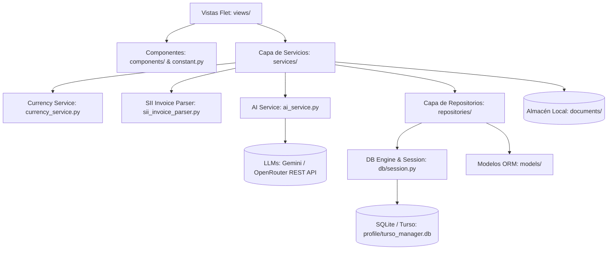

# 09. Estructura del Proyecto y Mapa de Archivos (Project Tree)

Este documento detalla la estructura completa de carpetas y archivos de **py-manager-lite**, proporcionando una descripción funcional de cada módulo para facilitar la navegación y el mantenimiento del código sin tener que bucear a ciegas en el repositorio.

---

## 1. Árbol General de Directorios

```text
py-manager-lite/
├── .agents/                    # Personalizaciones del asistente (Antigravity Customizations)
│   ├── rules/                  # Reglas del espacio de trabajo
│   │   └── project_tree_sync.md # Regla obligatoria de sincronización del árbol
│   └── skills/                 # Habilidades del asistente
│       ├── python-craftsmanship/ # Skill de calidad de código: PEP 8, PEP 20, typing y justificación
│       │   └── SKILL.md
│       └── sync-project-tree/  # Skill para mantener sincronizado docs/09-project-tree.md
│           └── SKILL.md
│
├── app/                        # Código fuente principal de la aplicación
│   ├── components/             # Componentes reutilizables de UI (Flet)
│   │   ├── __init__.py         # Exportación pública de componentes
│   │   ├── cards.py            # Componentes de tarjetas métricas, diálogos, snackbars y chips
│   │   ├── progress_modal.py   # Modal de progreso asíncrono con spinner, barra de %, empatía y log en vivo
│   │   └── sidebar.py          # Barra de navegación lateral persistente con menú y cambio de vistas
│   │
│   ├── core/                   # Configuración central del entorno, rutas y seguridad
│   │   ├── __init__.py
│   │   ├── config.py           # Detección de rutas base, DOCUMENTS_DIR dinámico, Turso config y DB_URL
│   │   └── security.py         # Criptografía PBKDF2 (100k iteraciones), cifrado simétrico AES-256-GCM y salts
│   │
│   ├── db/                     # Capa de infraestructura y motor de persistencia
│   │   ├── __init__.py
│   │   └── session.py          # SQLAlchemy 2 Engine, SessionLocal, migración de columnas e init_db
│   │
│   ├── models/                 # Modelos ORM (SQLAlchemy Declarative Base)
│   │   ├── __init__.py         # Exportación unificada de entidades y enumeraciones
│   │   ├── client.py           # Entidad Client (RUT, razón social, contacto, estado)
│   │   ├── company.py          # Entidades Company y BusinessCanvas (perfil corporativo)
│   │   ├── invoice.py          # Entidades Invoice, InvoicePayment, PurchaseOrder y Enums de estado
│   │   ├── project.py          # Entidad Project (fechas, presupuesto, estado, notas)
│   │   └── quote.py            # Entidades Quote y QuoteItem (cotizaciones y partidas)
│   │
│   ├── repositories/           # Capa de Acceso a Datos (Data Access Layer - CRUD puro)
│   │   ├── __init__.py
│   │   ├── client_repo.py      # Operaciones DB para clientes
│   │   ├── company_repo.py     # Operaciones DB para datos de empresa y canvas
│   │   ├── finance_repo.py     # Operaciones DB para facturas, pagos, notas de crédito y balances
│   │   ├── project_repo.py     # Operaciones DB para proyectos
│   │   ├── purchase_order_repo.py # Operaciones DB para órdenes de compra
│   │   └── quote_repo.py       # Operaciones DB para cotizaciones y sus ítems
│   │
│   ├── services/               # Lógica de Negocio y Reglas de Dominio (Service Layer)
│   │   ├── __init__.py
│   │   ├── ai_service.py       # Servicio agnóstico de IA (Google Gemini / OpenRouter) y extracción inteligente
│   │   ├── auth_service.py     # Autenticación, hashes PBKDF2 de contraseña/PIN y perfil cifrado
│   │   ├── backup_service.py   # Respaldo, exportación (.db/.sql/.zip), inspección e importación para Turso/LibSQL
│   │   ├── client_service.py   # Lógica y validaciones de clientes
│   │   ├── company_service.py  # Lógica de perfil empresarial y canvas
│   │   ├── currency_service.py # Formateador global de monedas y divisas (CLP, UF, USD, EUR, separadores)
│   │   ├── dashboard_service.py # Agregación de KPIs ejecutivos para la pantalla de inicio
│   │   ├── export_service.py   # Libros contables (ventas/compras), conciliación, F29 y reportes HTML/PDF
│   │   ├── finance_service.py  # Conciliación financiera, gestión de archivos y notas de crédito
│   │   ├── project_service.py  # Reglas de proyectos y cálculo de márgenes
│   │   ├── purchase_order_service.py # Gestión de OC y conversión automática a proyectos
│   │   ├── quote_service.py    # Emisión, cálculo de subtotales/IVA, duplicado y soft-delete
│   │   ├── sii_invoice_parser.py # Extractor nativo de metadatos desde facturas PDF del SII
│   │   └── turso_cloud_service.py # Conexión a Turso Cloud (HTTPS), diagnóstico de latencia y replicación Push/Pull
│   │
│   ├── views/                  # Pantallas y Vistas de Usuario (Flet Controls)
│   │   ├── __init__.py
│   │   ├── auth_view.py        # Pantalla de registro de perfil inicial y desbloqueo por PIN/contraseña
│   │   ├── clients_view.py     # Gestión de cartera de clientes (listado, filtros, modales)
│   │   ├── company_view.py     # Vista de perfil corporativo y Business Canvas interactivo
│   │   ├── exports_view.py     # Panel de exportación contable, selector de períodos y reportes ejecutivos
│   │   ├── finances_view.py    # Módulo financiero: facturas (emitidas/recibidas), pagos, OC y NC
│   │   ├── projects_view.py    # Gestión de proyectos, facturas asociadas y seguimiento
│   │   ├── quotes_view.py      # Cotizador: edición de partidas, filtros de fecha/cliente y papelera
│   │   └── settings_view.py    # Configuración general, Turso Cloud (Fase 5), formato moneda, backups e IA
│   │
│   ├── constant.py             # Design System centralizado: paleta de colores, fuentes y estilos
│   └── main.py                 # Punto de entrada de Flet, compuerta de login y enrutador
│
├── tmp/                        # [Ignorado en Git] Directorio temporal local y portabilidad
│   └── profile/                # Perfil activo, credenciales PBKDF2 y BD Turso/LibSQL
│       ├── ai_config.json      # Configuración de proveedor LLM (Gemini/OpenRouter), API Key y casos de uso
│       ├── backups_safety/     # Respaldos de seguridad automáticos preventivos antes de restauraciones
│       ├── currency_config.json # Configuración activa de formato monetario, separadores y divisa
│       ├── profile.json        # Credenciales de usuario y token de Turso Cloud cifrado (AES-256-GCM)
│       └── turso_manager.db    # Base de datos Turso / LibSQL local basada en archivos
│
├── data/                       # [Ignorado en Git] Almacén de base de datos SQLite local (app.db)
├── documents/                  # [Ignorado en Git] Repositorio de documentos subidos (facturas, OC, cotizaciones, backups)
│   └── backups/                # Respaldos generados (.db Turso, .sql Cloud y .zip completos)
├── test_invoice/               # [Ignorado en Git] Muestras locales de facturas para pruebas del parser nativo
│
├── tests/                      # Suite de Pruebas Automatizadas (Unit Tests)
│   ├── test_ai_service.py      # Pruebas unitarias de AIService, conectividad agnóstica y parsing de facturas
│   ├── test_backup_service.py  # Pruebas unitarias de exportación (.db/.sql/.zip), inspección y restauración Turso
│   ├── test_currency_service.py # Pruebas unitarias del formateador monetario, presets (CLP/UF/USD) y sufijos
│   ├── test_invoice_pdf.py     # Pruebas de lectura, extracción y validación de facturas PDF del SII
│   ├── test_progress_modal.py  # Pruebas unitarias de modal de progreso, cálculo de porcentaje y consola de logs
│   ├── test_services.py        # 20 pruebas unitarias de servicios, lógica financiera y soft-delete
│   ├── test_turso_cloud.py     # Pruebas unitarias de cifrado AES-256-GCM, salt PBKDF2 y Turso Cloud
│   └── test_views.py           # Pruebas de instanciación e integración de vistas Flet
│
├── docs/                       # Documentación técnica y funcional del proyecto
│   ├── 01-scope.md             # Alcance y visión del producto
│   ├── 02-domain-model.md      # Modelo de dominio y entidades
│   ├── 03-architecture.md      # Arquitectura en capas y diseño del sistema
│   ├── 04-flows.md             # Flujos funcionales clave
│   ├── 05-v0.1.md              # Especificaciones de la primera versión
│   ├── 06-roadmap.md           # Hoja de ruta y fases del proyecto
│   ├── 07-business-rules.md    # Reglas de negocio e impuestos (IVA, estados)
│   ├── 08-ai-handoff.md        # Guía de contexto para asistentes de IA
│   └── 09-project-tree.md      # Este documento (mapa del repositorio)
│
├── .gitignore                  # Exclusiones de Git (secretos, DB local, docs privados, caches, logs)
├── .env.example                # Plantilla pública de variables de entorno (sin credenciales reales)
├── AGENTS.md                   # Directrices y reglas de ingeniería obligatorias del proyecto
├── py-manager-lite.spec        # Especificación de PyInstaller para compilar binario ejecutable
├── requirements.txt            # Dependencias del proyecto (flet, sqlalchemy, pypdf, etc.)
├── README.md                   # Presentación general e instrucciones de instalación
└── run.py                      # Script de arranque rápido (`python run.py`)
```

---

## 2. Descripción Detallada por Componente

### 2.0 Personalizaciones del Asistente (`.agents/` y `AGENTS.md`)
- **[`.agents/rules/project_tree_sync.md`](file:///d:/ProyectoPython/py-manager-lite/.agents/rules/project_tree_sync.md)**: Regla contextual que obliga a mantener actualizado `docs/09-project-tree.md` ante cualquier modificación de archivos o carpetas.
- **[`.agents/skills/sync-project-tree/SKILL.md`](file:///d:/ProyectoPython/py-manager-lite/.agents/skills/sync-project-tree/SKILL.md)**: Habilidad modular con el procedimiento, checklist y criterios de calidad para sincronizar el árbol de proyecto.
- **[`.agents/skills/python-craftsmanship/SKILL.md`](file:///d:/ProyectoPython/py-manager-lite/.agents/skills/python-craftsmanship/SKILL.md)**: Habilidad de calidad y artesanía de código: formato PEP 8 (<= 120 caracteres, flake8 = 0 errores), filosofía PEP 20, tipado estricto PEP 560/484 y comentarios de justificación de negocio.
- **[`AGENTS.md`](file:///d:/ProyectoPython/py-manager-lite/AGENTS.md)**: Directrices globales del proyecto (sincronización de árbol, cumplimiento de estándares de código y ejecución de pruebas).

### 2.1 Raíz del Proyecto
- **[`README.md`](file:///d:/ProyectoPython/py-manager-lite/README.md)**: Presentación del proyecto, aviso legal y descargo de responsabilidad (proyecto exclusivamente educativo y de estudio de Python + Flet, no para uso comercial, sin garantías y exención de responsabilidad), resumen de la PoC cumplida, instalación y compilación.
- **`run.py`**: Wrapper ejecutable que añade el directorio raíz al `PYTHONPATH` y arranca `app.main:main`.
- **`requirements.txt`**: Librerías externas necesarias: `flet`, `sqlalchemy`, `pypdf`, `flake8`, `cryptography`, `requests`, `libsql-client`.
- **`py-manager-lite.spec`**: Archivo de compilación con PyInstaller para generar el ejecutable standalone (`.exe`).
- **`data/`**: Carpeta local donde reside `manager.db` (SQLite). Creada automáticamente en tiempo de ejecución.
- **`documents/`**: Directorio donde se almacenan organizadamente los PDFs e imágenes de facturas, órdenes de compra, cotizaciones, exportaciones y respaldos. La ubicación puede personalizarse dinámicamente en `profile.json` hacia cualquier carpeta local o sincronizada en la nube (Google Drive, OneDrive, Dropbox, etc.).
- **`test_invoice/`**: Facturas del SII en PDF para verificar la extracción nativa sin depender de servicios externos.

---

### 2.2 Núcleo de la Aplicación (`app/`)

#### Constantes y Entrada
- **[`app/constant.py`](file:///d:/ProyectoPython/py-manager-lite/app/constant.py)**: Fuente única de la verdad para el **Design System**. Define la paleta de colores en modo oscuro (fondos `#131920`, `#1B2430`, acentos esmeralda y cian, colores de estado para facturas, chips, tablas y botones). Cualquier cambio estético se realiza aquí.
- **[`app/main.py`](file:///d:/ProyectoPython/py-manager-lite/app/main.py)**: Configura la ventana principal de Flet (1366x768), inicializa la base de datos (`init_db()`), instancia el `Sidebar` y controla el intercambio dinámico de vistas según la navegación del usuario.

#### Configuración y Persistencia (`app/core/` y `app/db/`)
- **[`app/core/config.py`](file:///d:/ProyectoPython/py-manager-lite/app/core/config.py)**: Detecta si la app corre congelada (PyInstaller) o en desarrollo. Centraliza rutas absolutas seguras a `data/` y la gestión dinámica del almacenamiento de documentos (`get_documents_dir()`, `set_documents_dir()`, `DEFAULT_DOCUMENTS_DIR`), persistido en `profile.json`.
- **[`app/core/security.py`](file:///d:/ProyectoPython/py-manager-lite/app/core/security.py)**: Módulo criptográfico central. Implementa hashing PBKDF2 HMAC-SHA256 (100.000 iteraciones) para contraseñas/PIN, y cifrado simétrico autenticado AES-256-GCM con salt aleatorio e IV único para proteger tokens de bases de datos remotas en `profile.json`.
- **[`app/db/session.py`](file:///d:/ProyectoPython/py-manager-lite/app/db/session.py)**: Configura el motor SQLAlchemy con SQLite habilitando claves foráneas mediante PRAGMA. Implementa el context manager `get_db_session()` para transacciones atómicas seguras y el método `init_db()` con migraciones dinámicas no destructivas de columnas.

#### Capa de Modelos (`app/models/`)
- **[`client.py`](file:///d:/ProyectoPython/py-manager-lite/app/models/client.py)**: Modelo de clientes con soporte para RUT, teléfono, dirección, notas y marca de activo/inactivo.
- **[`company.py`](file:///d:/ProyectoPython/py-manager-lite/app/models/company.py)**: Perfil de la empresa propia y los 9 cuadrantes del Business Model Canvas.
- **[`invoice.py`](file:///d:/ProyectoPython/py-manager-lite/app/models/invoice.py)**: Define `Invoice` (facturas emitidas, recibidas y notas de crédito), `InvoicePayment` (registro de abonos parciales) y `PurchaseOrder` (órdenes de compra). Enums: `InvoiceType`, `PaymentStatus`, `PurchaseOrderStatus`.
- **[`project.py`](file:///d:/ProyectoPython/py-manager-lite/app/models/project.py)**: Modelo de proyectos, fechas de inicio/fin, presupuestos y relación con cliente y facturas.
- **[`quote.py`](file:///d:/ProyectoPython/py-manager-lite/app/models/quote.py)**: Cotizaciones y sus partidas (`QuoteItem`), con soporte para estados (Borrador, Enviada, Aceptada, Rechazada, Facturada, Oculta/Eliminada).

#### Capa de Repositorios (`app/repositories/`)
*Maneja exclusivamente las consultas a la base de datos (CRUD), sin conocimiento de la UI de Flet.*
- **[`client_repo.py`](file:///d:/ProyectoPython/py-manager-lite/app/repositories/client_repo.py)**: Búsquedas, ordenamiento alfabético y filtrado por estado activo.
- **[`company_repo.py`](file:///d:/ProyectoPython/py-manager-lite/app/repositories/company_repo.py)**: Obtención y actualización de la empresa emisora y bloques canvas.
- **[`finance_repo.py`](file:///d:/ProyectoPython/py-manager-lite/app/repositories/finance_repo.py)**: Registro de facturas, notas de crédito, cálculo de saldos pendientes y desglose por categorías.
- **[`project_repo.py`](file:///d:/ProyectoPython/py-manager-lite/app/repositories/project_repo.py)**: Creación, actualización y consulta de proyectos y sus facturas vinculadas.
- **[`purchase_order_repo.py`](file:///d:/ProyectoPython/py-manager-lite/app/repositories/purchase_order_repo.py)**: Control de órdenes de compra recibidas de clientes.
- **[`quote_repo.py`](file:///d:/ProyectoPython/py-manager-lite/app/repositories/quote_repo.py)**: Operaciones sobre cotizaciones y partidas con filtrado avanzado (cliente, fechas, exclusión de eliminadas).

#### Capa de Servicios (`app/services/`)
*Contiene la lógica de negocio, validaciones y cálculos.*
- **[`ai_service.py`](file:///d:/ProyectoPython/py-manager-lite/app/services/ai_service.py)**: Módulo de IA agnóstico a modelos (Google Gemini y OpenRouter). Implementa la arquitectura granular de la Fase 6 con 6 casos de uso desacoplados: extracción y normalización de facturas DTE SII (`invoices`), clasificación contable de gastos (`classify_expenses`), mejora de redacción comercial de cotizaciones (`improve_quotes`), sugerencia técnica de alcances SOW para partidas (`suggest_descriptions`), resumen ejecutivo de clientes (`summarize_client`) y diagnóstico ejecutivo de reportes financieros (`assist_reports`).
- **[`auth_service.py`](file:///d:/ProyectoPython/py-manager-lite/app/services/auth_service.py)**: Autenticación segura con PBKDF2 HMAC SHA-256 (100.000 iteraciones) para contraseña maestra y PIN de desbloqueo, gestión de `profile.json` y almacenamiento cifrado de credenciales de Turso Cloud con AES-256-GCM.
- **[`backup_service.py`](file:///d:/ProyectoPython/py-manager-lite/app/services/backup_service.py)**: Servicio de copias de seguridad y migración a Turso / LibSQL. Exporta copias binarias atómicas (.db) compatibles con `turso db create --from-file`, volcados SQL (.sql) compatibles con `turso db shell`, y paquetes (.zip) con configuraciones. Valida integridad con `quick_check`, crea respaldos de seguridad automáticos preventivos en `tmp/profile/backups_safety/` y restaura sin pérdida de datos.
- **[`client_service.py`](file:///d:/ProyectoPython/py-manager-lite/app/services/client_service.py)**: Validaciones de RUT, email y formato de teléfono.
- **[`company_service.py`](file:///d:/ProyectoPython/py-manager-lite/app/services/company_service.py)**: Gestión de información corporativa y modelo canvas.
- **[`currency_service.py`](file:///d:/ProyectoPython/py-manager-lite/app/services/currency_service.py)**: Servicio y formateador monetario global del sistema. Administra presets (CLP con punto de miles, UF con coma decimal, USD, EUR y personalizado), control de separadores, cantidad de decimales y adición de código de divisa al final. Persiste en `tmp/profile/currency_config.json`.
- **[`dashboard_service.py`](file:///d:/ProyectoPython/py-manager-lite/app/services/dashboard_service.py)**: Métricas ejecutivas de Fase 3 (tasas de cobro/pago, balance operacional), detector de vencimientos/pendientes, auditoría de documentos faltantes y bitácora unificada de actividad.
- **[`export_service.py`](file:///d:/ProyectoPython/py-manager-lite/app/services/export_service.py)**: Generación y exportación de Libros de Ventas y Compras en formato CSV compatible con SII y Excel (`utf-8-sig`), conciliación cronológica de cobros y pagos, estimación de IVA F29, auditoría documental y generación de informes financieros ejecutivos en HTML listos para imprimir a PDF.
- **[`finance_service.py`](file:///d:/ProyectoPython/py-manager-lite/app/services/finance_service.py)**: Conciliación financiera, gestión documental (adjuntos PDF/XML a facturas y vouchers de transferencias a pagos), emisión de notas de crédito y balances.
- **[`project_service.py`](file:///d:/ProyectoPython/py-manager-lite/app/services/project_service.py)**: Vinculación/desvinculación de facturas a proyectos, actualización de estado y cálculo de márgenes reales.
- **[`purchase_order_service.py`](file:///d:/ProyectoPython/py-manager-lite/app/services/purchase_order_service.py)**: Registro de OC y conversión de una orden aceptada a proyecto en un solo clic.
- **[`quote_service.py`](file:///d:/ProyectoPython/py-manager-lite/app/services/quote_service.py)**: Cálculo de subtotales, IVA (19%) y total; duplicación de cotizaciones existentes y soft-delete (recuperar/modificar eliminadas).
- **[`sii_invoice_parser.py`](file:///d:/ProyectoPython/py-manager-lite/app/services/sii_invoice_parser.py)**: Parser nativo con `pypdf` para extraer automáticamente RUT emisor/receptor, folio, fecha, montos netos, IVA y total de PDFs de facturas electrónicas del SII.
- **[`turso_cloud_service.py`](file:///d:/ProyectoPython/py-manager-lite/app/services/turso_cloud_service.py)**: Servicio de integración con Turso Cloud (Fase 5). Conexión HTTPS segura (`libsql-client`), diagnóstico de conectividad y latencia (ping en ms), recuento de tablas remotas, replicación en lotes Push (Local a Cloud) y Pull (Cloud a Local con respaldo preventivo).

#### Capa de Vistas (`app/views/`)
*Interfaces gráficas construidas íntegramente con Flet.*
- **[`auth_view.py`](file:///d:/ProyectoPython/py-manager-lite/app/views/auth_view.py)**: Pantalla de primer inicio (creación de perfil seguro, contraseña maestra, PIN y selección de carpeta de almacenamiento predeterminada o sincronizada con la nube) y pantalla de desbloqueo rápido con PIN o contraseña.
- **[`dashboard_view.py`](file:///d:/ProyectoPython/py-manager-lite/app/views/dashboard_view.py)**: Centro de mando y trazabilidad de Fase 3 con tarjetas de KPI, comparativa visual (Facturado vs Cobrado y Recibido vs Pagado con barras de progreso), panel de vencimientos con semáforo, bitácora cronológica de actividad y modal de auditoría documental.
- **[`clients_view.py`](file:///d:/ProyectoPython/py-manager-lite/app/views/clients_view.py)**: Listado de clientes, buscador dinámico en tiempo real, modal de creación/edición y botón de Resumen Ejecutivo con IA (`summarize_client`) en el detalle del timeline.
- **[`quotes_view.py`](file:///d:/ProyectoPython/py-manager-lite/app/views/quotes_view.py)**: Cotizador completo con constructor de partidas, botones de asistencia IA para redacción comercial (`improve_quotes`) y sugerencia técnica de partidas (`suggest_descriptions`), filtros combinados y sección especial de cotizaciones eliminadas.
- **[`projects_view.py`](file:///d:/ProyectoPython/py-manager-lite/app/views/projects_view.py)**: Vista de proyectos, carga directa de facturas asociadas (con parser SII automático y asistencia de IA), desvinculación rápida y métricas de avance.
- **[`finances_view.py`](file:///d:/ProyectoPython/py-manager-lite/app/views/finances_view.py)**: Módulo de finanzas con 4 tabs dedicados, banner de KPIs interactivo, pagos parciales, vouchers, notas de crédito SII, extracción de facturas IA (`invoices`) y botón de clasificación contable de gastos con IA (`classify_expenses`).
- **[`exports_view.py`](file:///d:/ProyectoPython/py-manager-lite/app/views/exports_view.py)**: Vista de reportes y exportación contable (Fase 4): selector de períodos con presets, botón de Diagnóstico Ejecutivo IA (`assist_reports`), delimitador CSV configurable, mini-KPIs dinámicos e historial interactivo.
- **[`company_view.py`](file:///d:/ProyectoPython/py-manager-lite/app/views/company_view.py)**: Edición de la empresa emisora y matriz visual interactiva del Business Model Canvas.
- **[`settings_view.py`](file:///d:/ProyectoPython/py-manager-lite/app/views/settings_view.py)**: Panel de configuración general, diagnóstico técnico, formato monetario del sistema, perfil seguro, panel de **Turso Cloud & Sincronización Remota (Fase 5)**, tarjeta de **Uso de IA (Fase 6)** con 6 switches granulares independientes y panel de **Copia de Seguridad y Migración Turso**.

#### Componentes UI Reutilizables (`app/components/`)
- **[`sidebar.py`](file:///d:/ProyectoPython/py-manager-lite/app/components/sidebar.py)**: Menú de navegación colapsable y estilizado con iconos, estados activos y disparador de navegación.
- **[`cards.py`](file:///d:/ProyectoPython/py-manager-lite/app/components/cards.py)**: Tarjetas métricas estandarizadas (`MetricCard`), cabeceras de sección (`SectionHeader`), chips de estado con colores temáticos (`StatusChip`), y funciones utilitarias de diálogo (`open_dialog`, `close_dialog`, `show_snackbar`).
- **[`progress_modal.py`](file:///d:/ProyectoPython/py-manager-lite/app/components/progress_modal.py)**: Modal flotante (`OperationProgressModal` y helper `run_operation_with_progress`) con spinner circular (`ProgressRing`), barra de progreso animada, cálculo porcentual dinámico, frases amables de empatía de usuario y consola de log en vivo (live terminal) con timestamps. Se ejecuta en hilo secundario desacoplado del hilo de interfaz de Flet.

#### Capa de Pruebas Automatizadas (`tests/`)
- **[`test_ai_service.py`](file:///d:/ProyectoPython/py-manager-lite/tests/test_ai_service.py)**: Pruebas unitarias para `AIService`, validación de providers agnósticos (Gemini/OpenRouter), generación de texto y JSON, pruebas de conectividad y ejecución desacoplada de los 6 casos de uso granulares con degradación amigable ante fallos.
- **[`test_backup_service.py`](file:///d:/ProyectoPython/py-manager-lite/tests/test_backup_service.py)**: Pruebas unitarias para `BackupService`, validación de exportación a Turso (.db binario), volcado SQL (.sql), empaquetado ZIP, validación e integridad de respaldos y restauración con roundtrip.
- **[`test_currency_service.py`](file:///d:/ProyectoPython/py-manager-lite/tests/test_currency_service.py)**: Pruebas unitarias para `CurrencyService`, validación de presets (CLP, UF, USD, EUR), separadores de miles y decimales, y sufijos de divisa.
- **[`test_invoice_pdf.py`](file:///d:/ProyectoPython/py-manager-lite/tests/test_invoice_pdf.py)**: Suite de validación automatizada que escanea y lee todas las facturas en `test_invoice/` importando `parse_sii_document`, validando campos tributarios (folio, RUT emisor/receptor, montos, fecha) y confirmando el flujo completo de ingreso en base de datos.
- **[`test_progress_modal.py`](file:///d:/ProyectoPython/py-manager-lite/tests/test_progress_modal.py)**: Pruebas unitarias para `OperationProgressModal` y `run_operation_with_progress`, validando ciclo de vida del modal, actualización porcentual, agregado de logs en vivo, estados de éxito y captura granular de errores en hilos de trabajo.
- **[`test_services.py`](file:///d:/ProyectoPython/py-manager-lite/tests/test_services.py)**: Pruebas unitarias de servicios, transacciones financieras, gestión documental de Fase 2 (adjuntos y vouchers), seguridad PBKDF2 y soft-delete de cotizaciones.
- **[`test_turso_cloud.py`](file:///d:/ProyectoPython/py-manager-lite/tests/test_turso_cloud.py)**: Pruebas unitarias de cifrado AES-256-GCM, resistencia a manipulación (tamper resistance), enmascaramiento de tokens, persistencia cifrada en profile.json y diagnóstico de Turso Cloud.
- **[`test_views.py`](file:///d:/ProyectoPython/py-manager-lite/tests/test_views.py)**: Pruebas de instanciación, tabs de sub-vistas y renderizado de controles e interfaces Flet.


---

## 3. Diagrama de Flujo y Arquitectura



---

## 4. Guía Rápida: "¿Dónde busco o modifico...?"

| Si necesitas modificar... | Dirígete a... |
| :--- | :--- |
| **Colores, iconos, fuentes o bordes** | [`app/constant.py`](file:///d:/ProyectoPython/py-manager-lite/app/constant.py) |
| **Formato de moneda, divisa (CLP/UF/USD), decimales o separadores** | [`app/services/currency_service.py`](file:///d:/ProyectoPython/py-manager-lite/app/services/currency_service.py) y [`app/views/settings_view.py`](file:///d:/ProyectoPython/py-manager-lite/app/views/settings_view.py) |
| **Exportar e importar todo en formato Turso (.db / .sql / .zip) o respaldos** | [`app/services/backup_service.py`](file:///d:/ProyectoPython/py-manager-lite/app/services/backup_service.py) y [`app/views/settings_view.py`](file:///d:/ProyectoPython/py-manager-lite/app/views/settings_view.py) |
| **Configuración de IA, proveedores (Gemini/OpenRouter) y casos de uso** | [`app/services/ai_service.py`](file:///d:/ProyectoPython/py-manager-lite/app/services/ai_service.py) y [`app/views/settings_view.py`](file:///d:/ProyectoPython/py-manager-lite/app/views/settings_view.py) |
| **Parser o lectura de facturas PDF del SII** | [`app/services/sii_invoice_parser.py`](file:///d:/ProyectoPython/py-manager-lite/app/services/sii_invoice_parser.py) |
| **Facturas, pagos o notas de crédito (lógica)** | [`app/services/finance_service.py`](file:///d:/ProyectoPython/py-manager-lite/app/services/finance_service.py) |
| **Pantalla de Finanzas o modales de facturas** | [`app/views/finances_view.py`](file:///d:/ProyectoPython/py-manager-lite/app/views/finances_view.py) |
| **Exportación para contador (Libros Ventas/Compras/Pagos)** | [`app/services/export_service.py`](file:///d:/ProyectoPython/py-manager-lite/app/services/export_service.py) |
| **Pantalla de Reportes, filtros de períodos y descargas** | [`app/views/exports_view.py`](file:///d:/ProyectoPython/py-manager-lite/app/views/exports_view.py) |
| **Cotizador, cálculo de IVA o partidas** | [`app/services/quote_service.py`](file:///d:/ProyectoPython/py-manager-lite/app/services/quote_service.py) y [`app/views/quotes_view.py`](file:///d:/ProyectoPython/py-manager-lite/app/views/quotes_view.py) |
| **Subida y asociación de facturas en proyectos** | [`app/views/projects_view.py`](file:///d:/ProyectoPython/py-manager-lite/app/views/projects_view.py) |
| **Menú lateral de la aplicación** | [`app/components/sidebar.py`](file:///d:/ProyectoPython/py-manager-lite/app/components/sidebar.py) |
| **Ruta de base de datos o almacenamiento de archivos (nube / local)** | [`app/core/config.py`](file:///d:/ProyectoPython/py-manager-lite/app/core/config.py), [`app/services/auth_service.py`](file:///d:/ProyectoPython/py-manager-lite/app/services/auth_service.py) y [`app/views/settings_view.py`](file:///d:/ProyectoPython/py-manager-lite/app/views/settings_view.py) |
| **Nuevas tablas o campos en la base de datos** | [`app/models/`](file:///d:/ProyectoPython/py-manager-lite/app/models/) y migración en [`app/db/session.py`](file:///d:/ProyectoPython/py-manager-lite/app/db/session.py) |
| **Añadir o correr pruebas unitarias** | [`tests/test_services.py`](file:///d:/ProyectoPython/py-manager-lite/tests/test_services.py) |
| **Pruebas de lectura de facturas PDF (test_invoice)** | [`tests/test_invoice_pdf.py`](file:///d:/ProyectoPython/py-manager-lite/tests/test_invoice_pdf.py) |
| **Pruebas del servicio de Inteligencia Artificial** | [`tests/test_ai_service.py`](file:///d:/ProyectoPython/py-manager-lite/tests/test_ai_service.py) |
| **Reglas del agente o sincronización de árbol** | [`.agents/rules/project_tree_sync.md`](file:///d:/ProyectoPython/py-manager-lite/.agents/rules/project_tree_sync.md) |
| **Instrucciones de la skill de sincronización** | [`.agents/skills/sync-project-tree/SKILL.md`](file:///d:/ProyectoPython/py-manager-lite/.agents/skills/sync-project-tree/SKILL.md) |
| **Estándares de código Python y typing** | [`.agents/skills/python-craftsmanship/SKILL.md`](file:///d:/ProyectoPython/py-manager-lite/.agents/skills/python-craftsmanship/SKILL.md) |
| **Turso Cloud (conexión, ping, push/pull o inspección)** | [`app/services/turso_cloud_service.py`](file:///d:/ProyectoPython/py-manager-lite/app/services/turso_cloud_service.py) y [`app/views/settings_view.py`](file:///d:/ProyectoPython/py-manager-lite/app/views/settings_view.py) |
| **Criptografía, salt, derivación de claves o AES-256-GCM** | [`app/core/security.py`](file:///d:/ProyectoPython/py-manager-lite/app/core/security.py) y [`app/services/auth_service.py`](file:///d:/ProyectoPython/py-manager-lite/app/services/auth_service.py) |
| **Base de datos Turso / LibSQL local** | [`tmp/profile/turso_manager.db`](file:///d:/ProyectoPython/py-manager-lite/tmp/profile/) y [`app/core/config.py`](file:///d:/ProyectoPython/py-manager-lite/app/core/config.py) |
| **Modal de progreso en vivo, spinner, barra de % y log en consola** | [`app/components/progress_modal.py`](file:///d:/ProyectoPython/py-manager-lite/app/components/progress_modal.py) y [`app/views/settings_view.py`](file:///d:/ProyectoPython/py-manager-lite/app/views/settings_view.py) |
| **Pruebas de Turso Cloud y seguridad criptográfica** | [`tests/test_turso_cloud.py`](file:///d:/ProyectoPython/py-manager-lite/tests/test_turso_cloud.py) |
| **Pruebas de modal de progreso y ejecución asíncrona** | [`tests/test_progress_modal.py`](file:///d:/ProyectoPython/py-manager-lite/tests/test_progress_modal.py) |

